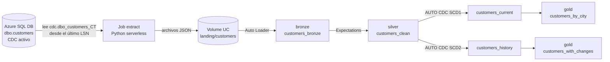

# Lakeflow CDC Demo: de Azure SQL a Databricks

Demo de punta a punta de **Change Data Capture (CDC)** desde **Azure SQL Database** hacia **Databricks**, usando **Lakeflow Spark Declarative Pipelines** y **Lakeflow Jobs**, desplegada como código con **Databricks Asset Bundles**.

Cambias datos en SQL (inserts, updates, deletes, un dato inválido), ejecutas un job y ves cómo los cambios viajan por las capas **bronze → silver → gold**, con el estado actual y el historial de cada cliente.

> Probada de punta a punta el 2026-10-20 (Azure CLI 2.87.0, Databricks CLI 1.12.1, Python 3.13). El bloque de Genie Code es manual y **no se probó**.

## Qué vas a aprender

| Tema | Dónde se ve |
|------|-------------|
| Ingesta incremental (Auto Loader + Streaming Tables) | `src/extract_cdc.py`, `src/pipeline/01_bronze.sql` |
| CDC con `AUTO CDC INTO` (SCD tipo 1 y 2) | `src/pipeline/02_silver.sql` |
| Arquitectura Medallion | `src/pipeline/*.sql` |
| Calidad de datos (Expectations) | `src/pipeline/02_silver.sql`, lote 3 |
| Orquestación (Lakeflow Jobs) e IaC | `databricks.yml` |

## Arquitectura



El **Lakeflow Job** `customers_cdc_job` encadena dos tareas: `extract` y, cuando termina, `refresh_pipeline` (que ejecuta el pipeline declarativo).

## Estructura del repositorio

```
.
├── databricks.yml          # Bundle: define el pipeline y el job (infraestructura como código)
├── env.example             # Plantilla de variables; cópiala a .env (no se versiona)
├── sql/
│   ├── 00_schema_cdc.sql   # Tabla fuente + habilitar CDC
│   ├── batch1_initial.sql  # Lote 1: 20 clientes
│   ├── batch2_changes.sql  # Lote 2: 5 updates, 2 deletes, 3 inserts
│   ├── batch3_bad_data.sql # Lote 3: email inválido
│   └── reset.sql           # Vacía la tabla y reactiva CDC
├── src/
│   ├── extract_cdc.py      # Extractor incremental (SQL -> JSON en Volume)
│   └── pipeline/           # Pipeline declarativo (SQL)
│       ├── 01_bronze.sql
│       ├── 02_silver.sql
│       └── 03_gold.sql
├── scripts/
│   ├── lote.sh             # Aplica un lote, espera a CDC y ejecuta el job
│   ├── reset.sh            # Deja la demo en blanco
│   ├── s.sh                # Consulta T-SQL sin escribir credenciales
│   └── q.py                # Consulta SQL en el warehouse de Databricks
└── docs/
    ├── GUIA.md             # Guion del webinar + construcción paso a paso (detalle completo)
    └── DEMO.md             # Versión corta para ejecutar y explicar la demo
```

## Requisitos

- Suscripción de Azure que **no** sea Free Trial (Databricks no se puede crear en Free Trial).
- Providers registrados: `Microsoft.Databricks` y `Microsoft.Sql`.
- Herramientas: [Azure CLI](https://learn.microsoft.com/cli/azure/), [Databricks CLI](https://docs.databricks.com/dev-tools/cli/), [`sqlcmd`](https://learn.microsoft.com/sql/tools/go-sqlcmd-utility) (go-sqlcmd), Python 3 y Bash.
- Sesión iniciada: `az login`.

## Paso a paso

Cada paso explica **qué hace**, **por qué** y **cómo comprobarlo**. El código completo comentado está en [`docs/GUIA.md`](docs/GUIA.md).

### Paso 1. Workspace de Databricks

```bash
az extension add -n databricks --yes
az group create -n rg-lakeflow-cdc-demo -l eastus2
az databricks workspace create -g rg-lakeflow-cdc-demo -n dbw-lakeflow-cdc -l eastus2 --sku premium \
  --query "{state:provisioningState,url:workspaceUrl}" -o json
```

- **Qué:** crea el grupo de recursos y el workspace (SKU `premium`).
- **Por qué:** el workspace ya trae Unity Catalog automático; el catálogo por defecto se llama como el workspace con guiones bajos (`dbw_lakeflow_cdc`).
- **Comprobar:**
  ```bash
  export DATABRICKS_HOST=https://<workspaceUrl>
  export DATABRICKS_AUTH_TYPE=azure-cli      # reutiliza az login, sin tokens
  databricks current-user me                 # tu usuario
  databricks metastores current              # metastore y default_catalog_name
  ```

### Paso 2. Azure SQL Database (serverless)

```bash
SRV=sql-lakeflow-cdc-$RANDOM
PW="Lk$(openssl rand -hex 8)!Aa"
az sql server create -g rg-lakeflow-cdc-demo -n $SRV -l centralus -u sqladmin -p "$PW"
az sql db create -g rg-lakeflow-cdc-demo -s $SRV -n cdcdemo \
  --edition GeneralPurpose --compute-model Serverless --family Gen5 \
  --capacity 1 --min-capacity 0.5 --auto-pause-delay 60 \
  --max-size 2GB --backup-storage-redundancy Local
az sql server firewall-rule create -g rg-lakeflow-cdc-demo -s $SRV -n AllowAzure \
  --start-ip-address 0.0.0.0 --end-ip-address 0.0.0.0
az sql server firewall-rule create -g rg-lakeflow-cdc-demo -s $SRV -n myip \
  --start-ip-address "$(curl -s https://api.ipify.org)" --end-ip-address "$(curl -s https://api.ipify.org)"
```

- **Por qué serverless vCore:** CDC funciona en cualquier tier vCore. En DTU exige S3 o superior (Basic, S0, S1 y S2 no lo soportan). Con auto-pause de 60 min no pagas en reposo.
- **Por qué `centralus`:** en esta suscripción `eastus2` rechazó crear servidores SQL (`RegionDoesNotAllowProvisioning`). El workspace puede seguir en `eastus2`; el tráfico de la demo es mínimo.
- **Firewall:** la regla `0.0.0.0` deja entrar a servicios de Azure (incluido el cómputo serverless de Databricks). Es aceptable para una demo, **no para producción**.
- **Credenciales:** copia `env.example` a `.env` y rellénalo. `.env` está en `.gitignore`.
  ```bash
  cp env.example .env
  ```

### Paso 3. Tabla fuente y CDC

```bash
set -a; . ./.env; set +a
sqlcmd -S "$SQL_SERVER" -d "$SQL_DB" -U "$SQL_USER" -P "$SQL_PASSWORD" -i sql/00_schema_cdc.sql
```

[`sql/00_schema_cdc.sql`](sql/00_schema_cdc.sql) crea `dbo.customers` y activa CDC con `sys.sp_cdc_enable_db` y `sys.sp_cdc_enable_table`.

SQL registra cada cambio en `cdc.dbo_customers_CT`. Dos columnas importan:

| Columna | Significado |
|---------|-------------|
| `__$operation` | `1` = delete, `2` = insert, `3` = update (imagen anterior), `4` = update (imagen posterior) |
| `__$start_lsn` | LSN: número que ordena los cambios en el log de transacciones |

No hace falta SQL Server Agent: en Azure SQL Database un scheduler interno captura los cambios.

### Paso 4. Schema, Volume y secretos en Databricks

```bash
C=dbw_lakeflow_cdc
databricks schemas create cdc_demo $C
databricks volumes create $C cdc_demo landing MANAGED
databricks secrets create-scope sql_demo
databricks secrets put-secret sql_demo host     --string-value "$SQL_SERVER"
databricks secrets put-secret sql_demo db       --string-value "$SQL_DB"
databricks secrets put-secret sql_demo user     --string-value "$SQL_USER"
databricks secrets put-secret sql_demo password --string-value "$SQL_PASSWORD"
```

- **Volume `landing`:** zona de aterrizaje de los archivos JSON. Desacopla la fuente del pipeline y deja una copia cruda auditable.
- **Secretos:** el extractor lee las credenciales de SQL desde un secret scope; nunca van en el código.

### Paso 5. Extractor incremental (`src/extract_cdc.py`)

Lee **solo los cambios posteriores al último LSN procesado**, los escribe como JSON en el Volume y avanza el watermark (tabla Delta `_cdc_watermark`).

Puntos clave:
- Solo conserva `__$operation IN (1, 2, 4)`: descarta la imagen anterior del update (3).
- Convierte el LSN a texto hexadecimal de ancho fijo, así se compara como cadena.
- `sys.fn_cdc_get_max_lsn()` evita leer cambios que SQL todavía está consolidando.
- Escribe primero y calcula conteo y watermark **leyendo lo escrito** (en serverless no existe `DataFrame.cache()`).
- Si no hay cambios, imprime `No new changes.` y no avanza el watermark.

### Paso 6. Pipeline declarativo (`src/pipeline/`)

| Archivo | Capa | Qué hace |
|---------|------|----------|
| [`01_bronze.sql`](src/pipeline/01_bronze.sql) | Bronze | `STREAMING TABLE` con `read_files` (Auto Loader): eventos CDC crudos, más `source_file` e `ingested_at` |
| [`02_silver.sql`](src/pipeline/02_silver.sql) | Silver | `customers_clean` con Expectations; `customers_current` (SCD1) y `customers_history` (SCD2) con `AUTO CDC INTO` |
| [`03_gold.sql`](src/pipeline/03_gold.sql) | Gold | Materialized Views: `customers_by_city` y `customers_with_changes` |

Los cuatro ingredientes de `AUTO CDC INTO`:

| Cláusula | Rol |
|----------|-----|
| `KEYS (customer_id)` | Qué identifica un registro |
| `SEQUENCE BY commit_time` | Cómo se ordenan los eventos |
| `APPLY AS DELETE WHEN op = 'D'` | Qué evento es un borrado |
| `STORED AS SCD TYPE 1 \| 2` | Sobrescribir (estado actual) o versionar (historial) |

En SCD2, `TRACK HISTORY ON city, status` limita el historial a esas dos columnas y cada versión lleva `__START_AT` / `__END_AT`.

Las **Expectations** de `customers_clean` descartan filas inválidas (`ON VIOLATION DROP ROW`) antes de que lleguen al CDC:
- `id_not_null`: `customer_id IS NOT NULL`
- `email_valid`: el email contiene `@` (salvo en borrados)

### Paso 7. Bundle: pipeline y job (`databricks.yml`)

```bash
databricks bundle validate
databricks bundle deploy
```

Un `deploy` crea el pipeline `customers_cdc_pipeline` y el job `customers_cdc_job` (`extract` → `refresh_pipeline`). El host del workspace se toma de `DATABRICKS_HOST`. El catálogo (`dbw_lakeflow_cdc`) y el schema (`cdc_demo`) están fijos en `databricks.yml` y en los archivos SQL/Python; si tu workspace tiene otro nombre, cámbialos ahí.

### Paso 8. Ejecutar los lotes

Cada lote repite el mismo ciclo: **cambiar datos en SQL → esperar ~15 s a que CDC capture → ejecutar el job (~2 min) → verificar**.

```bash
bash scripts/lote.sh 1    # carga inicial
bash scripts/lote.sh 2    # updates, deletes e inserts
bash scripts/lote.sh 3    # dato inválido
```

Verifica con `python scripts/q.py "<SQL>"`. Resultados esperados (verificados):

| Lote | Qué cambia en SQL | bronze | current | history |
|------|-------------------|:------:|:-------:|:-------:|
| 1 | 20 clientes nuevos | 20 | 20 | 20 |
| 2 | 5 updates, 2 deletes, 3 inserts | 30 | 21 | 28 |
| 3 | 1 cliente con email `correo-sin-arroba` | 31 | 21 | 28 |

- `current` baja a 21 en el lote 2 porque los clientes 19 y 20 se borraron y entraron 3 nuevos (20 − 2 + 3).
- En el lote 3 la fila **llega a bronze pero no a silver**: la Expectation `email_valid` la descarta.
- Conteos rápidos:
  ```sql
  SELECT
    (SELECT count(*) FROM dbw_lakeflow_cdc.cdc_demo.customers_bronze)  AS bronze,
    (SELECT count(*) FROM dbw_lakeflow_cdc.cdc_demo.customers_current) AS current_rows,
    (SELECT count(*) FROM dbw_lakeflow_cdc.cdc_demo.customers_history) AS history_rows;
  ```
- Historial SCD2 (el cliente 1 tiene dos versiones: Lima y luego Bogota; el 19, borrado, queda con su versión cerrada por `__END_AT`):
  ```sql
  SELECT customer_id, city, status, __START_AT, __END_AT
  FROM dbw_lakeflow_cdc.cdc_demo.customers_history
  WHERE customer_id IN (1, 3, 19)
  ORDER BY customer_id, __START_AT;
  ```
- Métricas de las Expectations (`<pipeline_id>` sale de `databricks pipelines list-pipelines`):
  ```sql
  SELECT details:flow_progress.data_quality.expectations
  FROM event_log('<pipeline_id>')
  WHERE event_type = 'flow_progress'
    AND details:flow_progress.data_quality.expectations IS NOT NULL
  ORDER BY timestamp DESC LIMIT 1;
  ```
  `email_valid` aparece con `failed_records: 1`.

### Repetir la demo

```bash
bash scripts/reset.sh
```

Destruye el bundle, borra las tablas del pipeline (`bundle destroy` las deja atrás), vacía el Volume, resetea la tabla SQL y vuelve a desplegar. Conserva los recursos de Azure, el schema, el Volume y los secretos.

## Scripts

| Script | Para qué |
|--------|----------|
| `scripts/lote.sh 1\|2\|3` | Aplica el lote en SQL, espera a CDC y ejecuta el job |
| `scripts/reset.sh` | Deja la demo en blanco |
| `scripts/s.sh "<T-SQL>"` | Ejecuta una consulta en Azure SQL sin escribir credenciales |
| `scripts/q.py "<SQL>"` | Ejecuta una consulta en el SQL warehouse serverless de Databricks |

Todos leen las variables de `.env` (ver `env.example`).

## Problemas conocidos

| Problema | Causa | Solución |
|----------|-------|----------|
| `RegionDoesNotAllowProvisioning` al crear el servidor SQL | `eastus2` no aceptaba servidores nuevos en esa suscripción | Crearlo en `centralus` |
| `NOT_SUPPORTED_WITH_SERVERLESS: PERSIST TABLE` | `DataFrame.cache()` no existe en serverless | Escribir primero y leer lo escrito para contar |
| `az databricks` falla en modo no interactivo | Extensión no instalada | `az extension add -n databricks --yes` |
| El job falla en `extract` con error de conexión | La base estaba pausada | Despertarla con `bash scripts/s.sh "SELECT 1"` y relanzar |
| `No new changes.` | CDC aún no capturó el lote | Esperar 15 s y ejecutar `databricks bundle run customers_cdc_job` |
| Los números no coinciden | Se repitió o saltó un lote | `bash scripts/reset.sh` y empezar de nuevo |

## Limitaciones

- `SEQUENCE BY commit_time` puede empatar si un mismo cliente cambia dos veces en el mismo milisegundo. En producción se ordena con el LSN y `seqval` como desempate.
- El transporte (job que lee las tablas `_CT`) está hecho a mano **a propósito**, para que se vea cómo funciona el CDC por dentro. En producción, el conector gestionado de **Lakeflow Connect** para SQL Server hace ese tramo sin código.
- La regla de firewall `0.0.0.0` y el login SQL con contraseña son solo para demo.
- No se verificó si el scheduler interno de CDC impide el auto-pause de la base.

## Costo y limpieza

- Azure SQL serverless factura solo mientras está activa (auto-pause de 60 min).
- El workspace de Databricks no cobra en reposo; se paga el cómputo serverless de cada ejecución y del warehouse mientras está encendido.
- Estimación gruesa: pocos USD por el día completo. Confirma en Cost Management.

Limpieza total (borra todo, incluida la base de datos):

```bash
az group delete -n rg-lakeflow-cdc-demo --yes --no-wait
```

## Documentación adicional

- [`docs/GUIA.md`](docs/GUIA.md): guion completo del webinar (qué decir, qué ejecutar y qué debería verse por bloque) y la construcción paso a paso con todo el código.
- [`docs/DEMO.md`](docs/DEMO.md): guía corta con el SQL listo para copiar y pegar.
